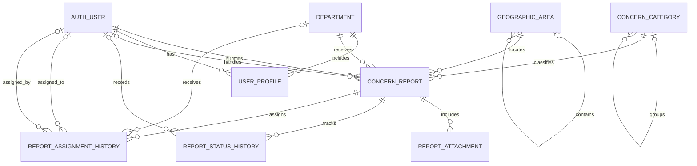

# Sulong-NIR Database Design

## 0. Current schema snapshot

[`current-schema.sql`](./current-schema.sql) is a schema-only export of the
project's configured SQLite database. It contains table, index, trigger, and
view definitions, but no application data. Regenerate it after applying
migrations whenever a current SQL reference is needed by running
`python sql/export_schema.py` from the repository root.

Django migrations in each app's `migrations/` directory remain the
authoritative, portable schema history. Do not edit the snapshot to apply
database changes; update Django models and migrations, then regenerate it.
[`bsitcrud.sql`](./bsitcrud.sql) is a historical MariaDB dump and is not the
current application schema.

## 1. Purpose and scope

This design is for Sulong-NIR as a local Negros Island Region concern-reporting
system. Residents submit a concern about a place or community issue; authorized
staff review, assign, update, and resolve it.

The repository uses Django with SQLite and has `Department`, `UserProfile`,
`ServiceRequest`, and `RequestUpdate` models. The service-request workflow is
oriented toward general, technical, access, and maintenance requests. The
separate `apps.concerns` Django app implements a community concern workflow,
with the operational scope and remaining deployment tasks noted below.

## 2. Design principles

- Keep one report record as the source of truth, with separate tables for
  categories, geographic areas, files, assignments, and history.
- Use Django's existing authentication user as the account record and reuse
  the existing `Department` table for handling offices.
- Store the report's current status and assignment for efficient lists, and
  retain their changes in history tables for accountability.
- Capture only the location and personal data needed to process a report.
- Permit location coordinates to be absent: a landmark or address is often
  more useful and safer than requiring GPS.
- Treat anonymous reporting as optional product behavior. If enabled, an
  anonymous report has no linked reporter account; do not store an identity
  merely to make the field non-null.

## 3. Entity relationship diagram

`AUTH_USER` is Django's configured user table (normally `auth_user`); it is
shown once even though it participates in several relationships.

## 4. Logical tables

Types below are conceptual and map naturally to Django model fields. Primary
keys can use Django's default `BigAutoField`; public report references should
be unguessable UUIDs, not sequential IDs.

### Existing account and office tables

| Table | Important fields | Purpose |
|---|---|---|
| `auth_user` | `id` PK, `username` unique, password hash, email, active/staff flags | Django login and permissions. Never store plaintext passwords. |
| `tbluserprofile` | `id` PK, `user_id` unique FK, `department_id` nullable FK, `role`, `status`, optional employee/contact details | Existing profile extension for staff and members. |
| `tbldepartment` | `id` PK, `code` unique, `name` unique, description | Existing office/department directory. |

Prefer Django's group/permission framework for granular authorization; the
profile role can remain the application's business-facing role.

### Concern-reporting tables

| Table | Important fields | Purpose |
|---|---|---|
| `geographic_area` | `id` PK, `parent_id` nullable self-FK, `level`, `name`, `code` nullable, `is_active` | Region → province → city/municipality → barangay hierarchy. Use unique `(parent_id, name)` and, where supplied, unique `(parent_id, code)`. Seed the official areas served by the deployment. |
| `concern_category` | `id` PK, `parent_id` nullable self-FK, `name`, `description`, `is_active`, `sort_order` | Configurable concern taxonomy (for example roads, drainage, waste, public safety). Use unique `(parent_id, name)`. |
| `concern_report` | `id` PK, `reference` UUID unique, `subject`, `description`, `category_id` FK, `priority`, `status`, `reporter_id` nullable FK, `department_id` nullable FK, `assigned_to_id` nullable FK, `area_id` FK, `location_details` nullable, `latitude`/`longitude` nullable decimals, `submitted_at`, `updated_at`, `due_at` nullable, `resolved_at` nullable | Main report. `reporter_id = NULL` represents an anonymous report if anonymous submissions are enabled. |
| `report_attachment` | `id` PK, `report_id` FK, `uploaded_by_id` nullable FK, `file` storage key, `original_name`, `content_type`, `size_bytes`, `uploaded_at` | Metadata for evidence files. Store file bytes in protected media storage, not as database blobs. |
| `report_status_history` | `id` PK, `report_id` FK, `actor_id` nullable FK, `old_status`, `new_status`, `comment`, `visibility`, `created_at` | Append-only audit of status changes and report updates. `visibility` distinguishes public updates from staff-only notes. |
| `report_assignment_history` | `id` PK, `report_id` FK, `department_id` nullable FK, `assignee_id` nullable FK, `assigned_by_id` nullable FK, `note`, `assigned_at`, `ended_at` nullable | Assignment and reassignment history. Keep the active assignment reflected in `concern_report` for efficient filtering. |

### Suggested values

- `geographic_area.level`: `region`, `province`, `city_municipality`,
  `barangay`. Validate parent/child level combinations in application logic.
- `concern_report.status`: `submitted`, `under_review`, `referred`,
  `in_progress`, `waiting_for_reporter`, `resolved`, `rejected`, `withdrawn`.
- `concern_report.priority`: `low`, `normal`, `high`, `urgent`.
- `report_status_history.visibility`: `public`, `staff_only`.
- Categories should be maintained as data, not hard-coded into report columns.

## 5. Relationships and deletion rules

- A report belongs to one geographic area and one category. Its reporter,
  handling department, or assignee may be absent.
- Do not hard-delete submitted reports or their history during normal
  operations. Use a retention policy and restricted administrative archiving.
- Deleting a user should not delete a report. Preserve the report and set the
  reporter/actor reference to null or anonymize personal data under an approved
  retention policy.
- Deleting a department, geographic area, or category referenced by reports
  should be prevented; mark the record inactive instead.
- Deleting a report attachment can remove the stored file only through the
  application's controlled deletion process. History rows should cascade only
  when a report is explicitly purged under the retention policy.

## 6. Constraints and indexes

Recommended constraints:

- Unique `concern_report.reference` (UUID).
- `latitude` between -90 and 90 and `longitude` between -180 and 180; require
  both values together or neither.
- `resolved_at` set only when the report enters a terminal state; clear it if
  an authorized workflow reopens the report.
- Non-negative `report_attachment.size_bytes`; enforce a configured upload
  size limit at the application layer.
- In a status-history row, `old_status` may be empty only for initial
  submission; new status must be valid.
- Prevent more than one active assignment for the same report in application
  transactions, or add a database constraint where the selected database
  supports conditional unique constraints.

Recommended indexes for common screens and reports:

- `concern_report(status, priority, submitted_at)`
- `concern_report(area_id, status, submitted_at)`
- `concern_report(department_id, status, submitted_at)`
- `concern_report(reporter_id, submitted_at)`
- `concern_report(assigned_to_id, status)`
- `report_status_history(report_id, created_at)`
- `report_assignment_history(report_id, assigned_at)`
- `report_attachment(report_id, uploaded_at)`

For free-text search over subject and description, use the search facility of
the selected database; ordinary B-tree indexes are not suitable for
`contains`/full-text searches.

## 7. Core data flow

1. A resident submits a report with its concern category, area, and issue
   details. The application creates a UUID reference and an initial
   `report_status_history` entry in the same database transaction.
2. Staff review the report and assign it to a department or staff member. The
   current assignment fields and a `report_assignment_history` entry are
   updated together in a transaction.
3. Each status change appends a `report_status_history` entry. Public-facing
   messages are explicitly marked `public`; internal notes remain
   `staff_only`.
4. Resolution records `resolved_at` and a final status-history entry. Reopening
   the report clears `resolved_at` and records the transition.
5. The report owner can view only their own identified reports. Anonymous
   tracking, if supported, should rely on a secure, revocable tracking
   credential rather than a predictable database ID.

## 8. Local deployment and operations

SQLite is suitable for a single-machine prototype or low-volume local
deployment. Keep database and uploaded-media files outside public static
directories, restrict filesystem access, and back up both the database and
media. Test restoration periodically. Enable HTTPS and protect backups because
reports can contain personal or sensitive information.

If Sulong-NIR is deployed for concurrent use by multiple offices or machines,
plan a tested migration to PostgreSQL rather than sharing a SQLite database
file over a network share. Run schema changes through Django migrations, and
keep operational audit events separate from debug logs.

## 9. Implementation status and deployment setup

The `apps.concerns` app implements the report, category, geographic area,
attachment metadata, status history, and assignment history models; resident
submission and tracking; staff status and assignment updates; staff-only
comments; Django admin configuration; and an initial migration. The migration
seeds common concern categories and the NIR region plus its three provinces.
The **Interactive Map** sidebar page includes a map with report counts rolled
up to those provinces and status filters. It renders the simplified province
boundaries from [geoBoundaries Philippines ADM2](https://github.com/wmgeolab/geoBoundaries/tree/41af8f1/releaseData/gbOpen/PHL/ADM2)
(sourced from NAMRIA, PSA, and OCHA Philippines; 2020; CC BY 3.0 IGO).
Province shading represents counts, not exact report locations. The shapes are
bundled in `static/geojson/nir-provinces.geojson`. The map uses Mapzen/AWS
Terrain Tiles elevation data for shaded relief, with a geographic mask so
surrounding land remains hidden. It displays only the three NIR provinces
without street-map tiles; province fill color represents the selected concern
count, and the view is constrained to the region. A bundled simplified
barangay-boundary layer contains 1,353 barangays (662 Negros Occidental, 557
Negros Oriental, and 134 Siquijor) from the 2023 PSGC/NAMRIA snapshot. Barangay
boundaries and names appear at closer zoom levels; selecting a barangay shows
its municipality and province.

Before accepting reports from all localities, staff must add the supported
cities/municipalities and barangays in Django admin (and confirm the official
boundaries/codes against the current authoritative source). Categories are
editable in admin. Reporter authentication is required in the current UI;
anonymous submission/tracking and attachment upload/download are not enabled.
The resident form asks for an area and optional landmark/address only; it does
not request or display latitude/longitude.
The attachment table is metadata/storage groundwork only. Do not expose
uploaded files publicly; implement authorization, upload validation/scanning,
and protected download handling before enabling evidence uploads.

## 10. Mapping from the current project

- Reuse `apps.users.Department` (`tbldepartment`) and the configured Django
  user model.
- `ServiceRequest` (`tblservicerequest`) and `RequestUpdate`
  (`tblrequestupdate`) currently provide a useful workflow pattern, including
  UUID references, status, assignment, and update history.
- Their current request types and required logged-in requester do not fully
  model local community concerns, geographic areas, report evidence, public
  versus staff-only updates, or anonymous submissions. Do not silently treat
  technical-support requests as community concerns; either evolve this domain
  deliberately or add a separate concern-reporting domain.
- `Info` (`tblinfo`) duplicates personal fields such as name, address, and
  email. Avoid making it the reporter's identity source; use the authenticated
  user/profile and collect report-specific contact details only when the
  workflow needs them.

## 11. Privacy and access-control notes

- Restrict staff-only comments, reporter contact details, and uploaded evidence
  to authorized roles. Do not expose file storage paths as public URLs.
- Validate and scan uploads; allow only needed file types and size limits.
- Avoid precise GPS collection unless required. Explain how location is used.
- Define retention, redaction, and access-audit rules with the local office
  before production use. Apply applicable Philippine privacy requirements.
- Anonymous reports cannot receive account-based status notifications. State
  this limitation clearly if anonymous submission is offered.
